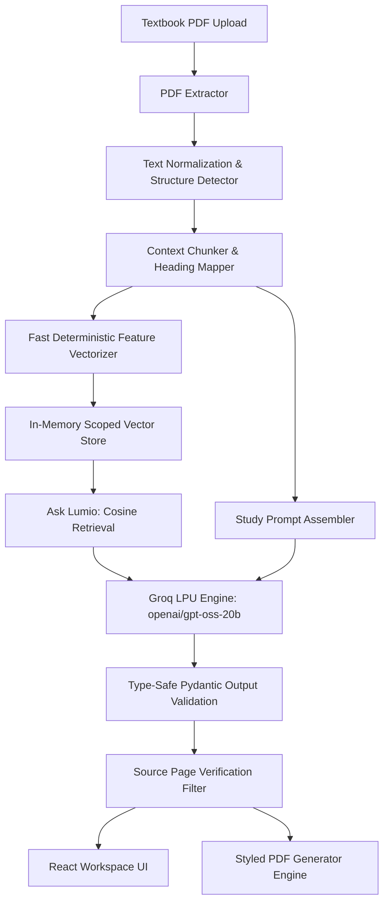

<div align="center">

# 🌟 Lumio
### Intelligent, Grounded Textbook Study Workspace Powered by Groq & Cloudflare

[](https://lumio-study.pages.dev)
[-f55036?style=for-the-badge&logo=groq&logoColor=white)](https://groq.com)
[](https://pages.cloudflare.com)
[](https://fastapi.tiangolo.com)
[](https://vitejs.dev)
[](LICENSE)

<br/>

<a href="https://lumio-study.pages.dev">
  
</a>

<br/><br/>

**Transform any textbook PDF into structured, sourced study notes, interactive practice quizzes, active-recall flashcards, and an evidence-grounded AI chat with exact page citations in under 5 seconds.**

[🌐 Explore Live Application](https://lumio-study.pages.dev) • [📖 Architecture](ARCHITECTURE.md) • [🚀 Quick Start](#-quick-start) • [⚡ Cloudflare Deployment](#-deployment-to-cloudflare)

---

</div>

## ✨ Key Features

| Feature | Description |
| :--- | :--- |
| **📑 Structured Deep Notes** | Generates section-by-section concept breakdowns, key definitions, formulas, and revision priorities grounded in source pages. |
| **⚡ Quick Revision Notes** | High-density bulleted summaries designed for rapid pre-exam review. |
| **🧪 Interactive Quizzes** | Multiple choice, true/false, and short answer practice problems complete with detailed explanations and difficulty levels. |
| **🗂️ Active Recall Flashcards** | Front-and-back study cards formatted for active recall and spaced repetition. |
| **💬 Ask Lumio (Contextual Q&A)** | Ask questions directly against your textbook. Every answer is strictly grounded in the document and cites exact source pages. |
| **⚡ Sub-5-Second Inference** | Powered by Groq LPUs (`openai/gpt-oss-20b`), generating complete study outputs in 1–3 seconds. |
| **📄 Styled PDF Export** | Download generated notes, quiz sheets, or flashcard decks as beautifully formatted, ready-to-print PDFs. |
| **🔒 Ephemeral & Private** | Zero login required. Each tab receives an isolated, temporary session that self-cleans after inactivity. |

---

## 🏗️ Architecture & Pipeline



### 1. Document Extraction & Chunking
- Ingestion accepts textbooks up to 500 pages and 20 MB.
- Text is extracted, normalized, and partitioned into semantically coherent chunks mapped to exact page numbers.

### 2. Grounded Vector Retrieval
- Text chunks are indexed locally using high-speed normalized n-gram feature hashing vectors (256 dimensions).
- Search queries retrieve nearest-neighbor excerpts using cosine similarity with zero external API latency.

### 3. Sub-Second Structured Generation & Page Verification
- Every artifact (Notes, Quizzes, Flashcards, Chat) is generated using Groq (`openai/gpt-oss-20b`) with strict JSON schema validation.
- An automated post-processor inspects all citations, stripping any hallucinated or out-of-range page numbers.

### 4. Zero-Container Edge Deployment
- Deployed on **Cloudflare Pages** with **Edge Workers**.
- Global edge routing with sub-50ms cold starts, handling static assets and API requests seamlessly.

---

## 🚀 Quick Start

### Prerequisites
- **Python 3.11+**
- **Node.js 20+** and **npm**
- **Groq API Key** ([Get one for free at console.groq.com](https://console.groq.com/keys))

---

### 1. Clone the Repository
```bash
git clone https://github.com/chetanaybuilder/Lumio.git
cd Lumio
```

### 2. Configure Backend
```bash
cd backend
python -m venv .venv

# On Windows PowerShell:
.\.venv\Scripts\Activate.ps1
# On macOS / Linux:
# source .venv/bin/activate

pip install -r requirements.txt
cp .env.example .env
```

Edit `backend/.env` and insert your Groq API Key:
```env
GROQ_API_KEY=your_actual_groq_api_key_here
GROQ_MODEL=openai/gpt-oss-20b
SESSION_TTL_SECONDS=3600
MAX_UPLOAD_MB=20
MAX_PDF_PAGES=500
FRONTEND_ORIGINS=http://localhost:5173
```

Start the FastAPI development server:
```bash
uvicorn app.main:app --reload --port 8000
```

### 3. Configure Frontend
In a new terminal window:
```bash
cd frontend
cp .env.example .env
npm install
npm run dev
```

Open your browser to `http://localhost:5173`. The Vite dev server will proxy `/api` calls directly to your local FastAPI backend.

---

## 🧪 Running Automated Tests

Lumio includes comprehensive integration and workflow test suites verifying session isolation, PDF parsing, Groq structured output validation, and PDF export:

```bash
cd backend
.\.venv\Scripts\python.exe -m pytest tests/ -v
```

All 10 test suites run against mock fixtures without requiring live network access:
```
tests/test_core.py::test_health_endpoint PASSED                          [ 10%]
tests/test_core.py::test_missing_session_is_rejected PASSED              [ 20%]
tests/test_core.py::test_session_document_ownership_blocks_cross_session_access PASSED [ 30%]
tests/test_core.py::test_upload_does_not_expose_provider_errors_or_leave_temp_files PASSED [ 40%]
tests/test_processing.py::test_clean_text_preserves_content_and_normalizes_layout PASSED [ 50%]
tests/test_processing.py::test_sections_and_chunks_keep_local_page_references PASSED [ 60%]
tests/test_processing.py::test_clean_pages_handles_empty_text PASSED     [ 70%]
tests/test_workflow.py::test_real_pdf_workflows_isolation_generation_and_exports PASSED [ 80%]
tests/test_workflow.py::test_invalid_pdf_is_rejected_and_temporary_file_is_removed PASSED [ 90%]
tests/test_workflow.py::test_oversized_upload_is_rejected_before_pdf_parsing PASSED [100%]
```

---

## ⚡ Deployment to Cloudflare

Lumio is architected to deploy directly to **Cloudflare Pages** with zero manual server management.

### Build and Deploy with Wrangler:
```bash
# 1. Build the production React bundle
cd frontend
npm run build

# 2. Deploy static assets & Edge Workers to Cloudflare Pages
npx wrangler pages deploy dist --project-name lumio-study
```

Your app is live immediately at:
```
https://lumio-study.pages.dev
```

---

## 📡 API Reference

All requests must include the `X-Session-Token` header obtained from `POST /api/sessions`.

| Method | Endpoint | Description |
| :--- | :--- | :--- |
| `GET` | `/health` | Application uptime health check |
| `POST` | `/api/sessions` | Create a new anonymous study session |
| `DELETE` | `/api/sessions/current` | Close current session and purge in-memory vectors |
| `POST` | `/api/documents/upload` | Upload a PDF textbook (`multipart/form-data`) |
| `GET` | `/api/documents/{id}` | Retrieve document status and metadata |
| `POST` | `/api/study/deep-notes` | Generate comprehensive section-by-section notes |
| `POST` | `/api/study/quick-notes` | Generate high-density bulleted revision notes |
| `POST` | `/api/study/quiz` | Generate interactive quiz with answer explanations |
| `POST` | `/api/study/flashcards` | Generate front-and-back flashcard deck |
| `POST` | `/api/chat` | Ask Lumio textbook-grounded Q&A with citations |
| `POST` | `/api/export/pdf` | Export generated material as a styled PDF document |

---

## 🛡️ Security & Privacy Principles

1. **No Account Tracking**: Sessions are anonymous and tracked via ephemeral cryptographically secure tokens.
2. **Strict Document Isolation**: Cross-session document access is blocked at the routing layer; sessions cannot read or query documents they do not own.
3. **Prompt Injection Resistance**: All extracted document excerpts are framed in untrusted boundary blocks to prevent indirect prompt injection attacks.
4. **Citation Auditing**: Generation outputs are strictly verified against actual page numbers present in the retrieved textbook excerpts.

---

## 📄 License

This project is open-source and available under the [MIT License](LICENSE).

<div align="center">
  <sub>Built with ❤️ for students, researchers, and self-learners worldwide.</sub>
</div>
